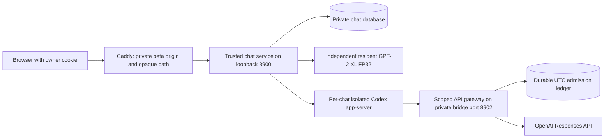

# GPT-2 and Codex conversation lab

This application adds Codex as a third participant beside a Human and the
original GPT-2 XL. Development lives on `codex/gpt2-codex` in
`.worktrees/gpt2-codex`, based on streaming branch revision `c9dbe09`.
The separate beta uses its own source checkout, service, browser origin,
conversation database, Codex workspaces, and API admission ledger.

## Conversation behavior

The chat contains any sequence of `Human>`, `GPT-2>`, and `Codex>` messages.
Each message begins with two newlines, its speaker marker, and space-prefixed
content. GPT-2 sees the exact retained context displayed in the browser:
the fixed introductory header and a suffix of conversation messages.
Packing counts the complete prompt with the real GPT-2 tokenizer, preserves
the latest message, and reserves **120 output tokens** within its 1,024-token
window. Older messages remain in private history after they leave that window.
An omission hint is included in the token budget.

New browser chats have an **Include an example round** checkbox, unchecked by
default. Checking it adds one demonstration round; the backend can still
validate zero, one, or two example rounds. The
header retains the original model's identity and date and introduces Codex
as a modern participant with tools. A GPT-2 turn appends only the `GPT-2>`
generation cue to the current context; it need not follow a Human message.
The original checkpoint, tokenizer, FP32 computation, and sampling settings
remain in use. A generated speaker delimiter ends the reply, and streaming
withholds incomplete Unicode and speaker-marker prefixes. Committed replies
also discard a terminal incomplete delimiter candidate.

The composer offers **Auto**, **Codex**, and **GPT-2** recipients. Auto lets
Codex assess the Human's intent. An explicit Codex recipient requires Codex
to contribute first; an explicit GPT-2 recipient requires a GPT-2 query first.
Codex may then respond, query GPT-2 again, or wait. Each visible Codex
contribution is brief, at most 100 words and 700 characters. LF line breaks
and ordinary blank lines are allowed. Only a double newline immediately
followed by a speaker tag and `>` is reserved for message boundaries.
An action permits at most three visible contributions and two GPT-2 queries.
Codex reasoning, tool output, and raw final answers stay outside the chat;
`emit_message` is the only route for a visible Codex message.

After a completed Human action, connected chats can receive autonomous
contributions after 60, 120, and 240 seconds. The allowance is cumulative:
at most three autonomous visible messages are permitted before another Human
message or a manual resume. An idle action with no visible contribution also
uses one allowance. `wait_for_human` ends this allowance immediately.
Examples alone cannot start autonomous work.

The right-hand GPT-2 context footer shows an animated, positive countdown
while an autonomous turn is scheduled. A
draining bar and remaining-time text show progress toward the next turn.
Waiting for the Human uses a separate status rather than an expired countdown.
The display uses the server's scheduling state and does not issue model/API
queries. The countdown is deployed and browser-verified as of October 5, 2026
CDT; it supports reduced-motion preferences.

The **Continue** button beside **Waiting for you** asks Codex to act
immediately and renews the allowance for up to three autonomous visible
contributions. It adds no Human message and preserves the conversation and
Codex thread. Each manual request has a durable ID, so retrying or reloading
does not start the same action twice; the clock never submits Continue
automatically. The control is deployed and verified in the real browser;
click behavior was tested with a model-free mock. A live model action from
this button has not been tested.

Continue also appears beside a scheduled countdown. In that case it starts
the next action immediately and keeps the existing remaining autonomous
allowance; it does not renew three more contributions. Shortening a requested
recovery follow-up retains that follow-up's one-round limit.

While GPT-2 is working, the same footer instead shows an orange indeterminate
activity bar. **GPT-2 · preparing reply…** means no visible reply text has
arrived yet; processing a long context can take a while. It changes to
**GPT-2 · generating…** when text appears. The bar does not estimate completion
or remaining time. Reduced motion keeps static phase text and a static bar.
Errors, pause, loss of connection and leaving the page clear the indicator.

Safe Codex failure notices identify timeouts, process exits, and protocol
connection loss. Retryable failures offer **Continue** beside the notice;
the action preserves saved replies and adds no Human message. Reloading does
not retry a failed action automatically. Allowance/configuration/unknown
runtime failures remain distinct and require resolving the error or a new
Human instruction. Raw private API/subprocess errors are never displayed.
If a saved GPT-2 reply ended the failed action, manual Continue first gives
Codex a reply-only recovery action instead of regenerating that GPT-2 reply.

Pause and loss of browser presence suspend autonomous work. The browser sends
a presence pulse every 15 seconds; its lease lasts 45 seconds. A new Human
message interrupts the active action. Epoch checks prevent canceled Codex
tools or provisional GPT-2 output from committing into the newer turn.
Enter sends; Shift+Enter inserts a newline. GPT-2 progress is displayed from
the session's cumulative state while generation is in progress.

If a GPT-2 reply was saved before a Codex action was interrupted, an explicit
resume can persist a continuation for Codex to respond to that existing reply
or wait. The resumed event identifies the saved reply and forbids another
GPT-2 query; it does not replay the Human message or regenerate GPT-2. This
continuation survives restart. In the live follow-up, Codex resumed from the
saved reply and chose to wait for the Human without adding or regenerating
a message.

## Components and isolation



The trusted service runs as `gpt-2`. It owns one serialized chat worker and
one resident GPT-2 runner. This runner is independent of the public
`gpt2-public` process and does not submit work through the public service's
queue. The deployment uses one Torch thread and shares the existing
Hugging Face cache at `/home/gpt-2/.cache/gpt2-public/huggingface`.

Using the same checkpoint file allows the kernel to share read-only mapped
checkpoint pages between the two GPT-2 processes. Each process still has
its own Python objects, decoding state, KV cache, and intermediate tensors.
RSS and cgroup accounting can count these shared pages differently; a small
cgroup reading does not measure the complete model footprint. Combined
capacity must be checked on the running host, especially for cold starts
and near-full prompts. The installer requires at least 8 GiB of available
memory before starting the new service.

Codex uses the separately pinned **CLI 0.154.0**, `gpt-6.1-sol`, and medium
reasoning effort. A Codex app-server process is launched for each action and
resumes that chat's saved thread. Its persistent Codex home and workspace
are mounted only into that chat's container. The service account receives
permission to invoke a constrained root-owned launcher and is not granted
general Docker access.

The container has a read-only root filesystem, dropped capabilities,
`no-new-privileges`, a 768 MiB memory limit with no additional swap allowance,
one CPU, a 96-process limit, and a 128 MiB temporary filesystem. The launcher
enforces a 610-second lifetime; the bridge's action deadline is 600 seconds
(ten minutes), including GPT-2 generation and private background work. API
stream/read idle limits are 180 seconds, bounded by the overall action.
Cleanup removes only containers carrying this application's sandbox label.
The custom seccomp profile retains Moby v25.0.13's default rules and adds eight
namespace/mount syscalls for unprivileged nested Bubblewrap. It grants no host
capability. The source attribution, modification notice, and complete pinned
Apache 2.0 license/notice are in
[`deploy/codex-chat/THIRD-PARTY-NOTICES.md`](../deploy/codex-chat/THIRD-PARTY-NOTICES.md).
The launcher's asynchronous Docker command must retain its explicit `<&0`
redirect: Codex app-server receives JSON-RPC on stdin, and Bash otherwise
redirects an asynchronous command's stdin away from the parent pipe.

The private Docker network disables container-to-container communication.
Its host input rules permit only the API gateway on port 8902. The real
OpenAI key stays in the trusted service; containers receive an expiring,
revocable token scoped to their action. Parent and subagent API requests use
the same gateway and ledger. Provider-hosted tools, provider-side conversation
storage, alternate models, and alternate API routes are rejected. Shell
execution and subagents operate inside the isolated workspace. Public web
research uses bounded host tools that validate addresses and redirects.

## Private state and access

The beta origin serves only a randomly generated opaque path. That path is
an access capability: keep it out of source control, public documentation,
analytics, screenshots intended for sharing, and access logs. This document
deliberately does not contain its value.

A browser owner cookie provides additional conversation isolation. It is
`HttpOnly`, `SameSite=Strict`, path-scoped, and `Secure` when HTTPS is configured.
Requests that mutate chats must supply the configured origin. Knowing a chat
identifier without its owner cookie does not permit reading or changing it.
The opaque beta URL is still necessary for creating a new browser-owned chat;
this beta does not offer account login or a public chat directory.

The default private data directory is
`/home/gpt-2/.local/share/gpt2-codex`:

| Location | Contents |
| --- | --- |
| `chats.sqlite3` | Full transcripts, settings, message metadata, request identifiers, and conversation positions |
| `budget.sqlite3` | Durable API reservations and reported numeric usage |
| `agents/players/<session>/codex-home` | Private Codex thread and configuration state |
| `agents/players/<session>/workspace` | That chat's private code-execution files |

Human request identifiers are persisted before work is queued. Retrying a
receipt with the same identifier does not append another Human message.
An accepted pending Human action can be recovered after restart and browser
reconnection; a completed request retry does not schedule another action.
Each chat resumes its own Codex thread and retains its full transcript.
The browser displays at most the latest 1,000 history messages; exports retain
the complete private transcript, up to the service's 10,000-message limit.
At most 64 chats are accepted by this beta.

GPT-2 generation records retain the exact prompt, input and output token IDs,
effective settings, actual/requested seed, raw decoded result, stop reason,
timings, context position, and runtime/checkpoint provenance. Without an
explicit seed, the adapter records a fresh entropy-derived seed. Provisional
stream text is never committed or exported as a completed reply. The export
format is `gpt2-codex-chat`, version 1; the earlier two-party public-chat
archive is a separate format.

**Export chat** starts a direct, owner-scoped HTTP attachment download. This
was verified once in the in-app browser, where the previous temporary Blob
URL download was observed to fail silently. The owner also confirmed Chrome
opens the Save As location picker. The in-app browser subsequently showed
additional unnamed Stopped entries; the change is not proof that all browser
download failures are resolved. The separate JSON export endpoint remains
available. The page's notification below the composer confirms that a download
was requested; the browser reports whether it was saved and controls its own
download popup.

**Import chat** opens a JSON file picker for this application's version-1
exports. It restores the full public conversation, generation evidence,
settings and retained GPT-2 context into a separate, paused chat. The original
chat remains saved. Use **Resume activity** when ready; import itself queues
no generation and spends no API allowance. The imported chat starts a fresh
Codex thread with the restored conversation history; it does not resume the
archive's private native reasoning, workspace or old request IDs.

Files and serialized import requests are limited to 10 MiB and the existing
10,000-message limit. Invalid files, picker cancellation and failed imports
leave the selected conversation and unsent draft intact. LF line breaks and
ordinary blank lines are preserved. The picker rejects unsafe JSON integers
rather than silently rounding evidence; exported seeds use decimal strings.

Back up private chat, ledger, and Codex state using consistent SQLite backups
and private filesystem storage. Do not commit these files or use an old
budget database to reset a quota. Pause affected chats and let active work
finish before an operator restart when practical.

## Daily API admission allowance

The default allowance is **$10 per UTC day**, shared by every chat and all
parent/subagent calls in this application. Configure it with
`--daily-limit-usd` or the deployed `GPT2_CODEX_DAILY_LIMIT_USD` environment
setting. The setting must be positive and finite. Chess services do not charge
this beta ledger; only requests forwarded through this application's gateway
are included.

This is conservative local admission control. Before forwarding a request,
the gateway durably reserves an amount based on the normalized request's
UTF-8 byte length, 20,000 additional input-token units, and its output
allowance. The ledger's implemented reservation rates are $5 per million
input units and $15 per million output tokens. Requests are limited to
750,000 bytes and at most 16,384 output tokens per model response, including
private reasoning. This ceiling is independent of each public Codex message's
100-word/700-character limit and GPT-2's 120-token generation limit.

When authoritative completed usage supplies valid input/output counts, the
ledger settles that request at the applicable tier and releases unused
reservation. Rates per million tokens are:

| Request input length | Ordinary input | Cache read | Cache write | Output |
| --- | ---: | ---: | ---: | ---: |
| Up to 272,000 tokens | $2 | $0.10 | $2.50 | $10 |
| More than 272,000 tokens | $4 | $0.20 | $5 | $15 |

Reported cache-read/write counts select their rates. If cache-write counts
are absent, all noncached input uses the applicable cache-write rate as a
conservative upper estimate. A successful authoritative JSON completion or
SSE `response.completed` supplies final usage. Once captured, that final
report settles even if the client cancels or the connection closes before
transport EOF. Requests without an authoritative final report retain the full
original long-context reservation, including failed/canceled partial streams.

The current `charged_usd` total combines settled known-usage estimates and
unresolved holds; it drives admission and the browser's remaining allowance.
`admitted_usd` records gross reservations in the current accounting period.
Gross admissions can exceed the allowance as unused holds are released;
charged amounts and new holds remain gated by the unchanged $10 default cap.
All admission rows remain available for audit, including those excluded by
an explicitly recorded reset.

These reservations deliberately overestimate ordinary use. They are not an
invoice calculation or an OpenAI account-wide spending cap; other services
using the operator's key have their own accounting. Review the ledger's rates
against provider pricing before changing models, request limits, or pricing
assumptions. A settled figure remains an upper estimate when billing details
are incomplete, rather than a reconstructed provider invoice.
The model and standard service tier are enforced by the gateway. Rates were
checked against [OpenAI's pricing table](https://developers.openai.com/api/docs/pricing)
on October 5, 2026 CDT.

The first user-turn follow-up identified that the initial implementation kept
known requests' inflated reservations permanently. That policy could reject
a turn despite substantially lower reported usage. The settlement correction
preserves the existing ledger and $10 cap. The subsequent policy uses the
published short/long tiers and cache counters, replacing the earlier blanket
$5/$15 settlement estimate. The final follow-up suite completed 370 Python
tests with one existing skip, and all 52 Node frontend tests passed. The
allowance/reset/continuation changes were deployed and verified live. The
subsequent terminal-usage transport-race correction passed all 22 targeted
gateway tests and was deployed after chats were idle and agent containers
had exited.

### Explicit allowance reset and development accounting

The owner explicitly ordered the current allowance counter reset to zero and
development testing excluded from the user allowance. `reset_daily_allowance()`
records a UTC timestamp and admission-row cutoff transactionally. Earlier rows
and their reported usage remain in the database audit history, but no longer
charge the current allowance. Late results still update their excluded original
row. A reset does not erase provider charges or raise the configured $10 cap.
The live reset confirmed $0 used / $10 remaining while preserving all 22
existing admission records. The resumed continuation then made two new
requests; audited reconciliation of its reported tier/cache usage gives a
combined **$0.016187** ledger estimate, **$0 unsettled holds**, and
**$9.983813 remaining**. The private reconciliation record was retained;
no additional model calls were made.

When explicitly authorized, the operator can invoke the method from the trusted
service account without editing/deleting ledger rows:

```bash
sudo -u gpt-2 env PYTHONPATH=/home/gpt-2/GPT-2-codex/src \
  /home/gpt-2/.venvs/gpt2-public/bin/python - <<'PY'
from pathlib import Path
from gpt2_local.codex_chat_budget import DailyBudgetLedger

ledger = DailyBudgetLedger(
    Path('/home/gpt-2/.local/share/gpt2-codex/budget.sqlite3'),
    daily_limit_usd=10,  # Match the configured allowance.
)
print(ledger.reset_daily_allowance())
print(ledger.snapshot())
PY
```

Check the recorded reset timestamp/cutoff, zero charged amount, and full
remaining allowance before new user activity. Preserve admission row IDs and
all reset records. Future real-model development runs must use a separate
development ledger/gateway accounting instance. Model-free regression checks
make no billable model requests. Chess accounting remains separate.

## Deployment and operation

Deployment templates live in [`deploy/codex-chat`](../deploy/codex-chat).
The intended host layout is:

| Resource | Selection |
| --- | --- |
| Source checkout | `/home/gpt-2/GPT-2-codex` |
| Python environment | `/home/gpt-2/.venvs/gpt2-public` selected with this checkout's `PYTHONPATH` |
| Service | `gpt2-codex.service`, loopback port 8900 |
| Network unit | `gpt2-codex-network.service` |
| Operator environment | Root-owned `/etc/gpt2-codex.env`, mode 0600 |
| Operator records/backups | Root-owned `/var/lib/gpt2-codex-ops` |
| Sandbox image | `gpt2-codex-runtime:0.154.0` |

The environment records the public origin, opaque base path, trusted launcher
argument array, cache/source selection, timezone, and daily allowance. The
operator supplies the API credential to the trusted service environment;
never put it in a Git file or a sandbox argument. CLI launches require an
explicit isolation launcher; a bare Codex command is rejected.

The installer assumes the host's existing `gpt-2` UID/GID of 1015/1018,
the private `172.30.97.0/24` network, and the existing Caddy layout. Recheck
those prerequisites, available memory, image availability, and existing
service health before installation. The systemd template gives the chat
process one CPU, `MemoryHigh=8704M`, `MemoryMax=9G`, and `TasksMax=128`.
Container resources are additional Docker-managed allocations.

The operator sequence is to build the pinned sandbox image, install the
separate service/network/launcher, confirm private health and confinement,
exercise real Codex and GPT-2 turns, and then publish the beta origin.
`install.py --install` installs the new units; `--publish` appends only the
new beta site after private health succeeds. `smoke.py` uses a root-private
owner cookie/session and saves its transcript under the operator directory.
Smoke tests can spend API allowance and run GPT-2 inference.

Shared Caddy updates must hold `/run/lock/astra-caddy-config.lock`, preserve
the original site's bytes and configuration inode, validate the candidate,
write/fsync in place when the file is bind-mounted, signal the existing
process with SIGUSR1, and poll HTTPS readiness. A rollback also needs an
HTTPS readiness check. Preserve the public GPT-2 service, both chess
services, their environments, and their existing PIDs during this work.
Do not treat the new unit being active as proof of a working HTTPS route.

The API is rooted beneath the opaque base path:

| Method and suffix | Purpose |
| --- | --- |
| `POST /api/sessions` | Create a chat and owner cookie |
| `POST /api/sessions/import` | Validate a version-1 archive and create a separate paused chat |
| `GET /api/sessions/<id>` | Read committed state and provisional progress |
| `POST /api/sessions/<id>/message` | Accept a Human message, target, and durable request ID |
| `POST /api/sessions/<id>/continue` | Request immediate Codex activity with a durable `request_id`, without adding a Human message |
| `POST /api/sessions/<id>/presence` | Refresh or end browser presence |
| `POST /api/sessions/<id>/control` | Pause or resume |
| `POST /api/sessions/<id>/settings` | Set temperature; the reply cap remains 120 tokens |
| `GET /api/sessions/<id>/export` | Export private history and generation evidence |
| `GET /api/sessions/<id>/export/download` | Download the same archive as an HTTP attachment |
| `GET /health` | Read application health without generation |

## Verification boundary

At the initial October 5, 2026 CDT / October 6 UTC deployment checkpoint, the Linux suite
completed **338 Python tests successfully, with one existing skipped test**,
and **48 Node frontend tests** passed. After four additional web regressions,
the updated targeted web suite separately passed **17 tests**. After the
allowance/reset/continuation follow-up, the complete Linux suite ran **370
tests in 24.495 seconds, with one existing skip**, and all **52 Node frontend
tests passed**. The final transport-race correction subsequently passed
**22 targeted Linux gateway tests in 11.129 seconds**.
Coverage includes exact context packing, delimiter-safe streaming, durable
admission accounting, scoped gateway validation, simulated app-server
interaction, private-history restoration, recipient routing, request
idempotency, cancellation, presence scheduling, and loopback HTTP ownership
and origin checks.

Live checks passed a real Sol greeting and a GPT-2-first turn followed by Codex.
A background workflow executed offline Python (`385`), read Example Domain,
and received a private child-agent result (`56`). Native workspace-write and
child notification handling therefore passed real transport checks. A pause
canceled an active workflow and cleaned up its container in one observed
0.56-second interval without committing a stale public message.
Container checks found other host account directories invisible,
host ports 22/8899 blocked, external `1.1.1.1:443` unreachable, and an
unauthenticated gateway request rejected with HTTP 401.
The credential-free Bing RSS search returned useful IANA/RFC 2606 results,
and an IANA page read passed after the final web-module update.

After GPT-2 generation, the host reported 12,597 MiB available memory. Both
GPT-2 processes reported approximately 5.90 GiB of shared-clean pages each;
their PSS was approximately 3.87 GiB for the existing public process and
3.45 GiB for the beta. Both mapped the same checkpoint device/inode, confirming
shared checkpoint pages. Existing GPT-2/chess/Caddy PIDs remained unchanged.
These are short-run observations, not cold-start or sustained-capacity tests.

The private HTTPS site is published. The bare origin returned 404; its private
capability page and health returned 200. All four checked existing HTTPS
routes remained healthy. Browser checks passed pause/Enter behavior, reload
persistence, and creation of a fresh chat. The private capability remains
excluded from source and this document.

The initial deployment's historical snapshot admitted $8.317800 and reported
a $1.083945 usage estimate, with one interrupted request's usage unknown.
After the first user turn, historical admissions reached $9.821355. The earlier
blanket long-tier correction produced $1.892895 charged / $8.107105 remaining;
those are superseded historical estimates. The owner subsequently ordered an
audited reset to zero, exclusion of development testing, correct tier/cache
settlement, and a saved-reply Codex continuation. The live reset preserved all
22 earlier admissions and all five chat messages plus conversation/thread
metadata byte for byte. Codex resumed and chose to wait without appending a
message. Browser reload verified distinct Human/GPT-2/Codex colors, an
unchecked example checkbox, and an enabled Send button with ready status.
All five checked HTTPS health routes passed and existing service PIDs remained
unchanged. The terminal-usage transport-race correction is deployed; audited
reconciliation settled the continuation's two requests at $0.016187 total,
leaving $9.983813 with no unresolved holds. Chat state remained preserved
without repeating the continuation.

The October 5 CDT countdown/Continue follow-up passed **31 focused Linux
backend/HTTP tests** and **22 focused Node frontend tests**. A real-HTML
model-free browser preview confirmed a draining countdown and manual Continue
without adding a Human message or losing the draft/recipient. Beta deployment
preserved all seven idle chats and all admission rows. The refreshed live
browser showed the enabled Continue button, 12 retained messages, and no
error; the live button was not clicked. All five HTTPS health routes and
existing service PIDs remained healthy. No development model calls were made.
The import/HTTP-export follow-up passed **86 focused Linux Python tests** and
**34 Node frontend tests**. A real file-picker/HTTP-handler browser test restored
a synthetic three-message archive, exact multiline context, settings and draft
into a paused chat without model calls. The refreshed live beta downloaded its
55-message archive successfully; conversation, metadata and native thread ID
matched the private backup. The owner subsequently confirmed a working Chrome
Export/Save As flow; live beta import has not been tested. Deployment preserved
all seven chats and the API ledger.
Reboot recovery, cold-start/load capacity, and live rollback have not
been established. The measured snapshots and native bridge corrections are
recorded in
[`VERIFICATION.md`](../VERIFICATION.md).
